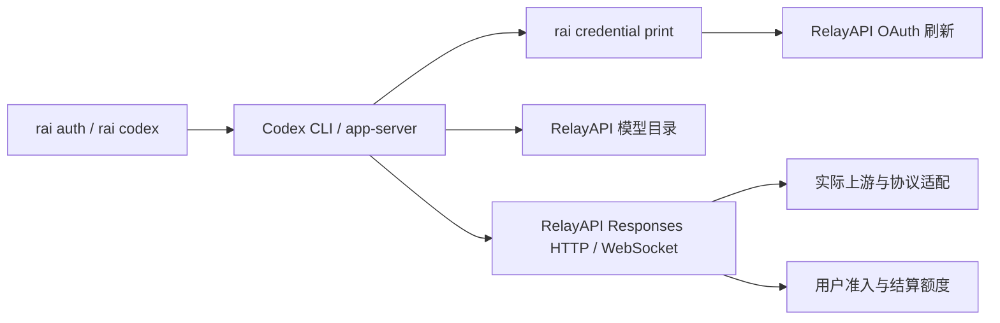

# rai 与 Codex 源码互操作分析

核查日期：2026-10-22。RelayAPI 基线：`e182013842fb7ef249a2200623322e097556b8ee`。本机客户端：`codex-cli 0.163.0`（Arch 包 `0.163.0+arch.1`）。上游对照同时包括发布标签 `rust-v0.163.0`（`129b8ec7ee6f4511557a4856279f529025c25af4`）和当天主分支 `342ed69a174c206c1de52a59491b131e0753cfa5`；下面涉及发布版行为的判断以 0.163.0 源码为准。

本文记录源码分析、已落实的适配和仍需验收的边界。现状见 [rai 使用文档](rai-cli.md) 与 [当前架构](rai-architecture.md)。

## 结论

保留 rai 管登录、凭据与启动，Codex 管会话和本地工具，RelayAPI 管协议、模型事实、授权与计费的分工。当前基本接入有效；主要问题是兼容假设滞后、配置所有权重复，以及功能声明缺少真实客户端验收。单改 rai 无法补齐新版压缩、真实模型元数据或服务端额度；也没有必要为这些功能另造 Codex 界面、维护客户端分支或恢复静态设备 Key。

本次已实现版本化 provider 能力协商、原生 CLI profile、helper 超时预算与续期回归、models.dev 完整能力快照及新目录投影，并在网关为 Chat/Responses 兼容上游补齐 compaction v2。真实 Codex 0.163.0 已验证 HTTP/WS 压缩和续接、HTTP 401 后同进程续期、原生 profile、目录与额度读取。旧字段保留用于旧客户端；当前传输决策使用 provider 契约。

目标是匹配官方客户端实际消费的协议与交互能力。Chat 上游的摘要质量、官方模型内部推理状态、官方专有工具以及 Desktop 界面不能由协议转换保证相同，不能将已通过的协议测试表述为所有模型与官方模型完全等价。

## 当前链路与已经验证的部分



`internal/rai/codex.go` 为单次启动注入自定义 Responses provider；`codex_configure.go` 向用户配置写入持久 provider；`codex_auth.go` 使用绑定 rai 目录、profile 和服务器的凭据助手。助手只输出 access token，OAuth refresh token 留在 rai 凭据存储。Codex 的 command auth 仍是官方支持方式，且不能与 `env_key`、静态 bearer 或 `requires_openai_auth=true` 混用。[官方配置说明](https://learn.chatgpt.com/docs/config-file/config-advanced#custom-model-providers)

本次实际执行以下隔离测试，全部通过：

```sh
CODEX_INTEROP_BINARY=/usr/lib/openai-codex/bin/codex \
  go test ./internal/rai ./internal/app \
  -run '^TestCodexClient' \
  -count=1 -v
```

测试使用临时 CODEX_HOME、本地 mock 与假凭据，验证持久配置通过真实 rai helper 拉取目录、轮换凭据、原生 `codex --profile … exec`、同进程 HTTP 401 自动续期、HTTP/WebSocket 额度，以及自定义上下文大小被客户端采用。另在 `third_party/cpaexecutor` 运行同名测试集合，通过真实 app-server 发起普通请求、`thread/compact/start` 和续接，覆盖 HTTP 与 WebSocket 到 Chat-only 上游的完整路径。桥接协议测试同时检查压缩与续接的 usage 关联。

CI 安装固定的 `@openai/codex@0.163.0`，打印版本，运行根模块与桥接模块的真实客户端测试。普通 `go test ./...` 未配置 `CODEX_INTEROP_BINARY` 时仍跳过这些项。本地已执行不代表远端 CI 已运行，也未覆盖其他客户端版本。源码入口：[helper 与 profile 测试](../internal/rai/codex_client_integration_test.go)、[续期测试](../internal/rai/codex_renewal_integration_test.go)、[额度测试](../internal/app/codex_client_integration_test.go)、[压缩与续接测试](../third_party/cpaexecutor/codex_client_integration_test.go)、[CI](../.github/workflows/ci.yml)。

## 1. 传输选择：旧目录字段已失效

0.163.0 的 `ModelInfo` 没有 `prefer_websockets`、`supports_parallel_tool_calls`、`max_output_tokens` 这三个字段。这仅表示它们不再是这个目录契约的有效控制字段，不表示并行工具、输出限制或其他 API 中的同名概念已不存在。Relay 的输出上限仍是有用的模型事实，也可能有其他消费者。

当前 Relay 仍在 `codex_catalog.go` 补这些字段，`native_models.go` 还会通过 `prefer_websockets=false` 表达某些模型的 HTTP 偏好；测试主要断言 JSON 字段值。新客户端却只通过 provider 的 `supports_websockets` 和会话 fallback 状态决定是否启用 Responses WebSocket，旧版 rai 曾固定写 `supports_websockets=true`，无法保证关闭偏好的模型真正改走 HTTP；本次已由版本化能力契约替代这一假设。[0.163.0 ModelInfo](https://github.com/openai/codex/blob/129b8ec7ee6f4511557a4856279f529025c25af4/codex-rs/protocol/src/openai_models.rs)、[传输开关](https://github.com/openai/codex/blob/129b8ec7ee6f4511557a4856279f529025c25af4/codex-rs/core/src/client.rs#L1106)

已在现有 session 响应加入 `codex.version=1`，包含 WebSocket、remote compaction v2 和 standalone search 能力。rai 启动时读取实时契约，持久配置时读取 OAuth session；静态 Key 使用登录保存的能力快照。旧服务器或未知契约版本使用 HTTP，重新登录/配置可刷新旧静态 profile。配置文件不会在网关策略变化时自动改写，需要重新配置；服务端始终继续执行当前策略。

契约覆盖当前 Key 可选择的全部模型及别名。嵌入式 CPA 的 WebSocket 状态机把每轮请求交给执行器，可转换到 Chat-only 上游；原生后备运行时没有这层能力，只为支持的 provider 启用 WS。管理员明确的 `PreferWebSockets=false` 会否决整个 provider 的 WS 开关，避免会话内切换模型失效。新版客户端不再依赖目录里的旧 transport 字段；兼容字段继续保留。

## 2. 配置：使用 Codex 原生 profile，减少双向同步

0.163.0 已支持共享 CODEX_HOME 下的 `<name>.config.toml`，作为用户配置之上的选定 profile 层。这可以复用历史、插件和其余用户设置，不需要另建一个 Codex home。[配置加载顺序](https://github.com/openai/codex/blob/129b8ec7ee6f4511557a4856279f529025c25af4/codex-rs/config/src/loader/mod.rs)

`rai configure codex --codex-profile relay` 现已写入 `<CODEX_HOME>/relay.config.toml`，保持根配置的原文、注释与共享历史。它避开根配置中已有 provider 名称，避免继承不相容的旧凭据。`codex --profile relay` 使用该配置；真实 CLI 已通过。`app-server` 子命令拒绝全局 `--profile`，不能据此宣称 Desktop 能原生选择这个文件。

`rai sync codex --codex-profile relay` 显式导入该文件的模型/推理设置；它不是项目配置和全部继承层的解析器。带原生 profile 的 rai 启动不再按根配置 mtime 自动回写偏好。未选原生 profile 的既有根配置导入保持兼容。rai 站点 profile 与 Codex 配置 profile 分别命名，透传 Codex 的 `--profile` 时需在 rai 参数后使用 `--`。

全局 `configure/unconfigure`、三方恢复 journal 与临时 Desktop 切换继续保留；原生 profile 也支持独立 unconfigure，恢复时保留用户后续编辑。本地文件配置无需网关新接口，不修改 Codex 会话数据库或安全策略。

## 3. 续期：机制有效，但缺少同一长会话的验收

rai 在 access token 距过期不足两分钟时刷新，使用跨进程锁串行消费 refresh token。本次将命令助手由五秒超时、五分钟检查调整为三十秒超时、每分钟检查，给十五秒 HTTP 预算及 keyring/锁操作留出空间。子进程不再额外接收 rai bearer 环境变量，Codex 由绑定的 helper 取得当前凭据。

0.163.0 的客户端会把认证 revision 纳入 WebSocket connection key，凭据变化会使旧连接失效并重新建立。因此“helper 续期永远不会影响已有 socket”也不准确。另一方面，Relay 对每个新 `response.create` 重新验证握手 token，过期时以 1008 关闭；这种关闭不能直接等同于 HTTP 401 的恢复路径。[Codex 连接复用](https://github.com/openai/codex/blob/129b8ec7ee6f4511557a4856279f529025c25af4/codex-rs/core/src/client.rs#L1660)、[Relay 每轮验证](../internal/app/native_websocket.go)、[rai 续期与锁](../internal/rai/oauth.go)

已用同一真实 `codex exec` 进程验证 HTTP 401 后重新调用 helper、轮换 refresh token、保存并继续请求。WS 到期关闭后的自动重连、慢网络和界面行为仍需单独验收。区分“可刷新过期”和“服务端撤销”，不自动放宽撤销检查，也不延长 token 来掩盖问题。若真实客户端无法从当前 WS 关闭恢复，再按它实际识别的认证错误协议调整网关。

超时修正和诊断主要在 rai；WS 错误协议或服务端会话行为需要中转站配合。目前没有证据需要给 Codex 再套本机代理。

## 4. 新版远程压缩：需要中转站和上游共同兑现

0.163.0 的 provider 支持 `capabilities.remote_compaction="v2"`。普通自定义 provider 默认是 `unsupported`，单有 `/responses/compact` 路由不会自动启用新版远程压缩；本次由明确的 provider 能力契约启用。

v2 通过正常 Responses 通路传递 `compaction_trigger`，客户端检查终态输出中恰好存在一个 compaction 项；这与旧的专用 compact 路由不是同一契约。[能力枚举](https://github.com/openai/codex/blob/129b8ec7ee6f4511557a4856279f529025c25af4/codex-rs/model-provider-info/src/capabilities.rs)、[provider 默认值](https://github.com/openai/codex/blob/129b8ec7ee6f4511557a4856279f529025c25af4/codex-rs/model-provider/src/capabilities.rs)、[v2 输出验证](https://github.com/openai/codex/blob/129b8ec7ee6f4511557a4856279f529025c25af4/codex-rs/core/src/compact_remote_v2.rs)

已复用当前 CPA 的 compaction summary/capsule codec，为 `openai-compatibility` 执行器补充 trigger 处理、摘要请求、compaction 输出和胶囊回放展开。Chat 与 Responses 两种上游均通过普通执行器处理摘要，保留授权、模型转换、正常 usage 和结算链路；向 Chat 上游发送前展开 compaction 项，不把加密字段直接交给不认识它的模型。HTTP/SSE 和 WebSocket 使用相同结果，客户端可在原连接继续请求。

这是一种摘要适配；胶囊由 CPA codec 封装，并非 OpenAI 原生私有状态，也不保证保留原生推理状态或相同摘要质量。没有增加数据存储或本机中转进程。普通 `openai` 凭据同时规范化为 CPA 的兼容路由名称，修复已注册自定义模型仍出现 `auth_not_found` 的问题。

服务端仅对实现了该路径的 provider 集合声明 compaction v2，Key 允许的任一模型落在集合之外就关闭 provider 声明。真实 Codex 对新增兼容执行器路径的 HTTP/WS 压缩与续接均已通过，其他既有原生执行器及真实商业上游仍需分别验证。不能将白名单理解为每个上游已完成在线验收。

## 5. 模型目录：保留完整形状，更新真正有效的内容

当前运行时从 slug 创建通用 ModelInfo，再应用能力快照和管理员覆盖。它不是简单透传 OpenAI 官方完整模型目录。旧版官方 slug 会跳过 models.dev，因而常使用通用 262144 上下文。本次允许第一方 OpenAI 资料覆盖，聚合商同名资料不能覆盖官方 slug；缺失资料时仍有通用缺省值与短 base instructions。

models.dev 现在为定价记录保留原始模型 JSON，并解析输入/输出上限、上下文、工具调用、结构化输出、温度、输入/输出模态、推理选项与描述。全部能力通过已有 PostgreSQL runtime setting 与价格在同一事务保存，未定价模型也能在重启后恢复资料，不生成虚假价格行。管理员按字段覆盖，明确的 false 不因合并丢失；资料不改变 Key、订阅或模型授权。

Codex 投影采用真实上下文、输入预算对应的 `effective_context_window_percent`、不超过输入预算与上下文 90% 的 `auto_compact_token_limit`，更新推理档位和输入模态。`tool_call=false` 的模型隐藏于 agent 选择器，仍可按现有权限通过公共 API 使用。旧 `max_output_tokens` 保留，但不用于证明新客户端输出限制生效。上下文/推理投影有单元与真实目录消费测试。

从 experimental modes 中仅提取已支持的 `service_tier=priority`，投影为 Fast 选项；不执行任意 provider body patch，也不声明未定价 ultrafast。现有路由和实际 service tier 计费继续生效；真实客户端已验证 HTTP/WS 发出 priority 请求；Fast 菜单显示与真实上游速度/可用性尚未在线验收。其他结构化输出、温度和输出模态保留为模型事实，不能强行映射成 Codex 不消费的字段。`model_messages.instructions_template` 和官方逐模型完整提示尚未引入，保留兼容的短 `base_instructions`。[ModelInfo 与 legacy 转换](https://github.com/openai/codex/blob/129b8ec7ee6f4511557a4856279f529025c25af4/codex-rs/protocol/src/openai_models.rs)

command auth 的远端目录仍可能与客户端内置目录按 slug 合并；现有隐藏 tombstone 仍有作用。完整 ModelInfo、权限过滤、别名目标校验、ETag 与坏目录拒绝都要保留。token 轮换会影响 opaque command-auth 的目录缓存身份，这是客户端防串账号的设计；不通过伪造 ChatGPT account ID 规避。[目录合并](https://github.com/openai/codex/blob/129b8ec7ee6f4511557a4856279f529025c25af4/codex-rs/models-manager/src/manager.rs)、[缓存身份](https://github.com/openai/codex/blob/129b8ec7ee6f4511557a4856279f529025c25af4/codex-rs/model-provider/src/models_identity.rs)

这些改进主要属于中转站的模型投影和管理配置；rai 不再保存一份完整模型能力数据库。

## 6. 额度、搜索与登录的边界

历史 0.158.0 的 `/status` 回归应保留为历史记录，不能继续笼统写成所有后续版本的既定限制。0.163.0 TUI 源码将已收到的额度快照交给状态卡片；`requires_openai_auth` 在卡片中控制 ChatGPT 用量链接，并非拒绝全部自定义 provider 数据的开关。主动账户额度轮询仍有 ChatGPT 账号条件。[状态卡片](https://github.com/openai/codex/blob/129b8ec7ee6f4511557a4856279f529025c25af4/codex-rs/tui/src/status/card.rs)、[快照传入](https://github.com/openai/codex/blob/129b8ec7ee6f4511557a4856279f529025c25af4/codex-rs/tui/src/chatwidget/status_controls.rs)

因此先补 TUI、状态栏和 Desktop 的单独验收，继续使用已经验证的 HTTP 额度头、WS `codex.rate_limits` 与 `rai quota`。首次请求前没有已准入子订阅，不能凭空推导其额度；空闲时持续刷新、多订阅同时展示也不能只靠多发几组响应头保证。当前单 bucket、至多两个窗口的策略继续保留，直至客户端消费与展示都通过新版测试。

`supports_standalone_web_search=true` 只声明兼容端点，官方说明它本身不会启用尚处开发中的 standalone search。Relay/CPA 存在 `/alpha/search` 路由，但还要按实际选择的上游验证请求、结果、图片引用、授权和用量；不能因为路由注册就对所有模型宣告端到端可用。[官方配置参考](https://learn.chatgpt.com/docs/config-file/config-reference)

Codex 的 `gateway_oauth` 是与主认证并存的第二层 OAuth，保留并禁止覆盖 Authorization 等头；它不是现有 rai device grant 的直接替代。当前没有必要新增一套 OAuth 服务器来替换已经工作的 helper。未来只有在明确采用“用户 ChatGPT 主凭据 + 企业网关身份”时才单独设计这条接入。[Gateway OAuth 验证](https://github.com/openai/codex/blob/129b8ec7ee6f4511557a4856279f529025c25af4/codex-rs/model-provider-info/src/gateway_oauth.rs)

rai 的 `inference/account` 授权、Codex 本地文件/命令权限和中转站模型/额度策略是不同边界；`auth login --scope account` 不应启用 Codex 本地更高权限。不要自动注入 `approval_policy=never`、放宽 sandbox 或修改用户的安全策略来追求少弹窗。

## 剩余验证与扩展

当前改动覆盖 rai、模型目录和嵌入式网关三层；仅修改 rai 无法提供这些协议能力，无需再架设一个中转站。部署新版 RelayAPI 并重新配置 rai 后才能取得新 provider 能力。

后续按真实行为推进：跨 token 到期的 WS 重连、真实上游工具/图像/搜索与 Fast、长上下文摘要质量、TUI `/status` 和 Desktop 面板/原生 profile，以及更多受支持 Codex 版本的矩阵。当前 CI 只固定 0.163.0，不承诺其他版本。保留旧客户端投影、完整隐藏条目、恢复 journal、设备授权和独立账户管理，避免清理文档时误删仍有消费者的兼容面。
